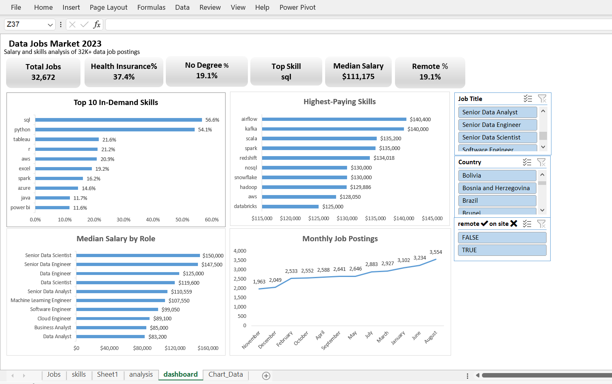
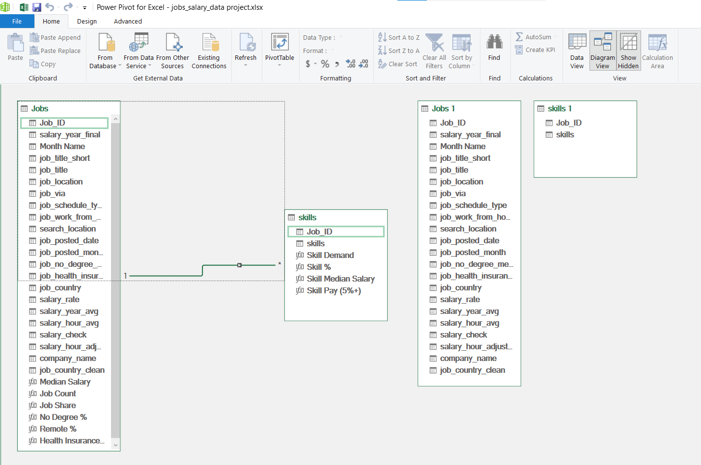

# Data Jobs Market Dashboard (Excel)

Interactive Excel dashboard analyzing **32,000+ data job postings (2023)** to answer:
which roles pay the most, which skills are in demand, and which skills drive higher salaries.

## 📥 Download the File
[Download the Excel file (Google Drive)](https://docs.google.com/spreadsheets/d/1wIPfYue4gCFk_9vV_xZJ0JR7VyCEjgPX/edit?usp=drive_link&ouid=111016104139460126294&rtpof=true&sd=true)

## 🛠 Tools
- **Power Query**: data cleaning and reshaping
- **Data Model**: two related tables (Jobs & Skills)
- **DAX**: measures for median salary, skill demand, and KPIs
- **PivotCharts and Slicers**: interactive dashboard

## 🧹 Data Cleaning Highlights
- Found and fixed a transformation step that had removed **53% of job postings** and all skills data
- Restructured the data into a **one-to-many model**: Jobs (one row per posting) and Skills (one row per skill)
- Corrected **1,200+ US jobs mislabeled as "Sudan"**
- Flagged **14 salary outliers** instead of deleting them
- Created a unified annual salary column (hourly rates converted × 2080)

## 📊 Key Insights
1. **SQL is the #1 skill** (57% of postings) but pays close to the median: a baseline requirement.
2. **Python is the sweet spot**: high demand (54%) and above-median pay ($122.5K).
3. **Data Analyst** is the most in-demand role (29%) but has one of the lowest medians ($83K).
4. **Senior Data Analysts earn 33% more** than Data Analysts.
5. For analysts, **Excel appears in 40% of postings** but is linked to the lowest pay ($77K).
6. **Data engineering tools** (Airflow, Kafka, Spark) pay the most: ~$135K–$140K.
7. Hiring **peaks in August** and slows down in November–December.

## ⚠️ Assumptions and Limitations
- Median used instead of average to reduce outlier impact
- Hourly salaries converted assuming full-time (2,080 hours/year)
- Data is mostly from the US; results may differ in other markets

## 📁 Data Source
[https://docs.google.com/spreadsheets/d/1IlQASFS_PMKkU4oIidWXWW72U2E5pLfb/edit?usp=sharing&ouid=111016104139460126294&rtpof=true&sd=true]
